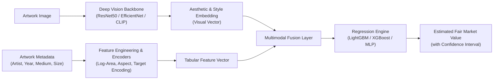

# CanvasIQ: Multimodal Art Piece Price Prediction & Valuation System


**CanvasIQ** is an end-to-end multimodal machine learning system that predicts the fair market valuation of fine art by synthesizing visual aesthetic attributes (via Deep Convolutional / Vision Networks) with historical and contextual metadata (artist pedigree, medium, creation period, and physical dimensions).

---

## 🎨 System Architecture



---

## 📁 Repository Structure

```text
CanvasIQ/
├── data/
│   ├── raw/                # Raw auction & artwork datasets
│   ├── processed/          # Cleaned & feature-engineered data
│   └── images/             # Artwork images (cached locally)
├── notebooks/              # Exploratory data analysis & experiments
│   ├── 01_eda_and_cleaning.ipynb
│   ├── 02_feature_extraction.ipynb
│   └── 03_multimodal_modeling.ipynb
├── src/
│   ├── data/               # Ingestion, scraping & dataset downloaders
│   ├── features/           # Vision extractors & tabular transformers
│   ├── models/             # Model definitions, training & evaluation
│   └── utils/              # Helper functions & configuration
├── app/                    # Interactive web application (Streamlit)
│   └── app.py
├── models/                 # Saved model weights & artifacts
├── requirements.txt        # Python package dependencies
└── README.md
```

---

## 🚀 Key Features

1. **Multimodal Late Fusion:** Fuses tabular auction metadata with high-dimensional deep visual features extracted from pretrained backbones.
2. **Log-Scale Valuation Modeling:** Handles heavy right-skewed pricing distributions typical in fine art markets.
3. **Interactive Appraisal UI:** User-friendly interface allowing collectors, appraisers, and enthusiasts to upload artwork images and input known metadata for instant valuation and explainability.

---

## 🛠️ Setup & Installation

### 1. Clone the repository
```bash
git clone https://github.com/Krishnanand-10/CanvasIQ.git
cd CanvasIQ
```

### 2. Set up virtual environment
```bash
python3 -m venv venv
source venv/bin/activate
pip install -r requirements.txt
```

---

## 📊 Dataset & Methodology
* **Inputs:**
  * **Tabular:** Artist name, creation year, medium, support, height, width, past auction trends.
  * **Visual:** Color palette, texture, compositional balance extracted via transfer learning.
* **Target:** Realized hammer price / market valuation ($\log(\text{price})$).
