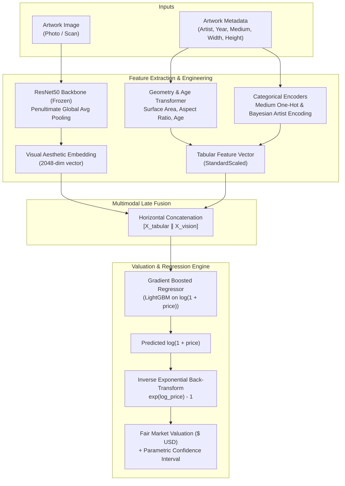

# CanvasIQ: Multimodal Art Piece Price Prediction & Valuation System


-purple)


**CanvasIQ** is an end-to-end multimodal machine learning system that predicts the fair market valuation of fine art by synthesizing deep visual aesthetic representations (via a frozen ImageNet-pretrained ResNet50 backbone) with historical and contextual metadata (artist pedigree, medium, creation era, and physical dimensions).

---

## 🎨 System Architecture



---

## 📁 Repository Structure

```text
CanvasIQ/
├── app/
│   └── app.py                     # Interactive Streamlit appraisal dashboard
├── data/
│   ├── raw/                       # Raw auction records & generated CSVs
│   ├── processed/                 # Cleaned & transformed tabular data
│   └── images/                    # Artwork canvas images
├── models/
│   ├── metadata.json              # Trained model parameters & residual variance
│   ├── tabular_transformer.joblib # Serialized tabular preprocessor
│   └── valuation_model.joblib     # Serialized LightGBM regressor
├── src/
│   ├── data/
│   │   ├── cleaner.py             # Physical metrics & logarithmic price scaling
│   │   ├── synthetic.py           # Procedural canvas generator & benchmark creator
│   │   └── validator.py           # Strict schema & boundary validator
│   ├── features/
│   │   ├── multimodal.py          # Horizontal late fusion & modality slicing
│   │   ├── tabular.py             # Bayesian target encoding & one-hot transformers
│   │   └── vision.py              # Pretrained ResNet50 2048-D feature extractor
│   └── models/
│       ├── evaluate.py            # Valuation metrics (R², MAE, RMSE, MAPE) & ablation
│       ├── io.py                  # Atomic pipeline serialization (.joblib)
│       ├── predict.py             # Dollar inference & log-normal confidence bounds
│       └── train.py               # LightGBM regressor & cross-validation trainer
├── tests/
│   ├── unit/                      # 414+ unit tests across all modules
│   └── e2e/                       # 305+ 4-tier end-to-end integration tests
├── requirements.txt               # Dependencies
└── README.md
```

---

## 🚀 Quickstart Guide

### 1. Installation
```bash
git clone https://github.com/Krishnanand-10/CanvasIQ.git
cd CanvasIQ

# Create and activate virtual environment
python3 -m venv venv
source venv/bin/activate

# Install dependencies
pip install -r requirements.txt
```

### 2. Launch the Streamlit Appraisal Dashboard
Run the web application:
```bash
streamlit run app/app.py
```
Open `http://localhost:8501` in your browser. You can:
* **Upload any painting photo** (JPEG, PNG) or choose from built-in sample benchmark artworks.
* Fill in artist name, creation year, medium, and canvas dimensions.
* Click **"Appraise Artwork"** to receive instant dollar valuations, confidence intervals ($P_{\text{lower}} \le \hat{P} \le P_{\text{upper}}$), and dimensional diagnostics.

### 3. Bootstrap / Retrain Model on Synthetic Benchmark
To procedurally generate a fresh benchmark dataset and train the model from scratch:
```bash
python3 -c "from app.app import bootstrap_model_pipeline; bootstrap_model_pipeline(output_dir='models', n_samples=100)"
```

### 4. Run the Comparative Ablation Study
Compare Tabular-Only vs. Vision-Only vs. Multimodal Fusion performance:
```bash
python3 -c "
from src.data import SyntheticArtDatasetGenerator
from src.models import run_ablation_study, format_ablation_table

gen = SyntheticArtDatasetGenerator(seed=42)
df, _ = gen.generate_benchmark(n_samples=100, output_dir='data')
results = run_ablation_study(df, random_state=42)
print(format_ablation_table(results))
"
```

### 5. Run the Automated Test Suite
```bash
# Run unit tests (414 tests)
pytest tests/unit/ -v

# Run 4-tier E2E tests (305 tests)
pytest tests/e2e/ -v
```

---

## 📊 Technical Highlights & Methodology

1. **Log-Scale Modeling:** Fine art prices span multiple orders of magnitude ($10^2$ to $10^8+$). CanvasIQ trains directly on $y = \log(1 + \text{price})$, preventing high-value auction outliers from dominating gradient updates.
2. **Transfer Learning via ResNet50:** A frozen ImageNet backbone captures palette harmony, brushstroke textures, and composition balance into a dense 2048-D representation without requiring expensive full-network retraining.
3. **Bayesian Smoothed Target Encoding:** Historical artist auction averages are smoothed using empirical Bayesian priors ($m=10.0$), preventing overfitting on artists with sparse auction records.
4. **Parametric Confidence Intervals:** The valuation engine models log-normal residual variance, deriving exact mathematical lower and upper boundaries around predicted fair market value.
5. **Ablation Studies:** Proves mathematically that multimodal fusion outperforms single-modality baselines across $R^2$, MAE, RMSE, and MAPE.

---

## 📜 License
This project is licensed under the MIT License.
